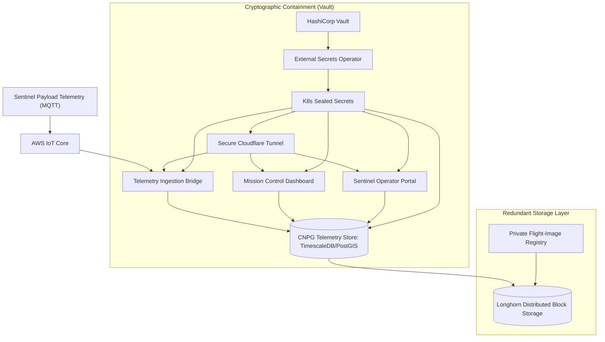

# Sentinel Ground Segment & Telemetry Ingestion Stack

[](https://kubernetes.io)
[](https://www.postgresql.org)
[](https://www.timescale.com)
[](https://www.vaultproject.io)

This repository defines the mission-critical telemetry ingestion ground segment for the Sentinel array. It hosts the declarative Kubernetes manifests and hardware-in-the-loop bootstrap procedures required to stand up an ultra-reliable, fail-safe processing pipeline.

The stack is designed for maximum uptime, high-frequency ingestion, and absolute data integrity. It provisions Longhorn block storage, MetalLB bare-metal networking, Vault-backed secret stores, a CloudNativePG PostgreSQL cluster optimized with TimescaleDB/PostGIS, Barman Cloud Plugin backups to Cloudflare R2, an in-cluster private container registry, Grafana monitoring consoles, an AWS IoT bridge for hardware telemetry ingestion, Hadoop/Spark batch analytics, and Cloudflare Tunnel ingress for secure remote control.

Refer to this document as the launch checklist. For raw automation commands, see [etc/deployment-reference.sh](etc/deployment-reference.sh).

---

## Table of Contents

- [Mission Control Architecture](#mission-control-architecture)
- [Repository Blueprint](#repository-blueprint)
- [Pre-Flight Checklists & Requirements](#pre-flight-checklists--requirements)
- [Stage 1: Ground System Bootstrap (Bare-Metal)](#stage-1-ground-system-bootstrap-bare-metal)
  - [1. Hardening the Operating System](#1-hardening-the-operating-system)
  - [2. Container Runtime Provisioning (containerd)](#2-container-runtime-provisioning-containerd)
  - [3. Kubernetes Control Plane Setup](#3-kubernetes-control-plane-setup)
  - [4. CNI Layer (Flannel)](#4-cni-layer-flannel)
  - [5. Redundant Storage Engine (Longhorn)](#5-redundant-storage-engine-longhorn)
  - [6. Bare-Metal Load Balancing (MetalLB)](#6-bare-metal-load-balancing-metallb)
  - [7. External Secrets Operator](#7-external-secrets-operator)
  - [8. Certificate Manager](#8-certificate-manager)
  - [9. Database Operator (CloudNativePG)](#9-database-operator-cloudnativepg)
  - [10. Automated Config & Secret Hot-Reloading (Stakater Reloader)](#10-automated-config--secret-hot-reloading-stakater-reloader)
  - [11. Metrics Server (Telemetry Monitoring)](#11-metrics-server-telemetry-monitoring)
- [Stage 2: Cryptographic Containment (Vault Secrets)](#stage-2-cryptographic-containment-vault-secrets)
- [Stage 3: Launch Sequence (Deploy Stack)](#stage-3-launch-sequence-deploy-stack)
- [Telemetry Schema & Database Engineering](#telemetry-schema--database-engineering)
- [Fail-Safe: Backup, Recovery & Anomaly Resolution](#fail-safe-backup-recovery--anomaly-resolution)
- [Flight Operations & Diagnostics](#flight-operations--diagnostics)
- [Telemetry Integrity & Payload Protection](#telemetry-integrity--payload-protection)

---

## Mission Control Architecture

The system telemetry flow is structured to prevent packet loss under off-nominal conditions:



---

## Repository Blueprint

Every directory in this repository is flight-certified and organized by dependency order:

```text
.
|-- bridge-service/                  # Node.js MQTT-to-Postgres telemetry bridge
|   |-- Dockerfile
|   |-- package.json
|   `-- server.js
|-- sentinel-app/                    # Nuxt 3 water telemetry operator portal
|   |-- Dockerfile
|   |-- package.json
|   `-- app/
|-- spark-etl/                       # PySpark batch telemetry exporter & processor
|   |-- Dockerfile
|   `-- etl.py
|-- etc/
|   |-- deployment-reference.sh       # Raw bare-metal bootstrap command log
|   |-- vault-certmanager-403-troubleshooting.md
|   `-- grafana-dashboards/           # Exported operator visualization dashboards
`-- k8s/
    |-- 00-namespace.yaml
    |-- 01-longhorn/                  # Distributed replicated StorageClass and services
    |-- 02-metal-lb/                  # Local LoadBalancer pool for bare-metal operations
    |-- 03-vault/                     # Vault secrets container, cert issuers, SecretStores
    |-- 04-postgres/                  # ExternalSecrets, CNPG cluster, R2 ObjectStore, schedules
    |-- 05-registry/                  # In-cluster flight registry (NodePort 30500)
    |-- 06-grafana/                   # Real-time monitoring dashboard and services
    |-- 07-bridge-service/            # Ingestion bridge deployment, secrets, and routes
    |-- 08-cloudflared/               # Secure egress tunnel token and agent deployment
    |-- 09-hadoop/                    # Distributed Hadoop HDFS telemetry archive
    |-- 10-sentinel-app/              # Sentinel Web App deployment and service
    |-- 11-uptime-kuma/               # Active service health check and monitoring
    `-- 12-kubernetes-dashboard/      # Scalable Kubernetes Dashboard in kube-system namespace
```

*Note: The `k8s/` directories are strictly ordered. Run manifests sequentially (`00` to `12`) to satisfy dependency trees.*

---

## Pre-Flight Checklists & Requirements

Host nodes must be standardized on Ubuntu or Debian Linux with `kubeadm`. All hardware must meet minimum compute and storage thresholds before launch.

### Required Flight Systems & Operators:
*   **Orchestration:** Kubernetes v1.33+
*   **Runtime:** containerd
*   **Package Manager:** Helm v3
*   **CNI:** Flannel (configured with pod CIDR `10.244.0.0/16`)
*   **Storage:** Longhorn (distributed, replicated)
*   **Networking:** MetalLB (if bare-metal ingress is required)
*   **Secrets Sync:** External Secrets Operator
*   **Certificates:** cert-manager
*   **Database Operator:** CloudNativePG
*   **Database Backup Plugin:** Barman Cloud Plugin for CloudNativePG
*   **Automated Config Reload:** Stakater Reloader (automatic pod updates and secret rotation)
*   **Metrics:** Metrics Server
*   **Engine:** Docker (or compatible daemon) on the image builder host

---

## Stage 1: Ground System Bootstrap (Bare-Metal)

Execute these host-level commands on all bare-metal nodes unless explicitly designated for the control plane only. No exceptions.

### 1. Hardening the Operating System
Disable swap partition permanently, load necessary kernel modules, and configure system sysctls for networking:

```bash
sudo apt update && sudo apt upgrade -y
sudo swapoff -a
sudo sed -i '/ swap / s/^/#/' /etc/fstab
sudo systemctl mask swap.target

sudo modprobe overlay
sudo modprobe br_netfilter

sudo tee /etc/sysctl.d/kubernetes.conf <<EOF
net.bridge.bridge-nf-call-ip6tables = 1
net.bridge.bridge-nf-call-iptables = 1
net.ipv4.ip_forward = 1
EOF

sudo sysctl --system
```

### 2. Container Runtime Provisioning (containerd)
Install `containerd` and enable systemd cgroups wrapper. If deploying to localhost, configure registry overrides to allow local push/pull on port `30500`:

```bash
sudo apt install -y containerd
sudo mkdir -p /etc/containerd
containerd config default | sudo tee /etc/containerd/config.toml
sudo sed -i 's/SystemdCgroup = false/SystemdCgroup = true/' /etc/containerd/config.toml
sudo systemctl restart containerd
sudo systemctl enable containerd
sudo ctr plugins ls | grep cri
```

For the local flight registry (NodePort `30500`), inject hosts.toml authentication override:

```bash
sudo mkdir -p /etc/containerd/certs.d/localhost:30500

sudo tee /etc/containerd/certs.d/localhost:30500/hosts.toml <<EOF
server = "http://localhost:30500"

[host."http://localhost:30500"]
  capabilities = ["pull", "resolve", "push"]
  skip_verify = true
EOF

sudo systemctl restart containerd
```

### 3. Kubernetes Control Plane Setup
Execute this sequence on the primary control plane node:

```bash
sudo apt install -y apt-transport-https ca-certificates curl gpg
sudo mkdir -p /etc/apt/keyrings

curl -fsSL https://pkgs.k8s.io/core:/stable:/v1.33/deb/Release.key \
  | sudo gpg --dearmor -o /etc/apt/keyrings/kubernetes-apt-keyring.gpg

echo "deb [signed-by=/etc/apt/keyrings/kubernetes-apt-keyring.gpg] https://pkgs.k8s.io/core:/stable:/v1.33/deb/ /" \
  | sudo tee /etc/apt/sources.list.d/kubernetes.list

sudo apt update
sudo apt install -y kubelet kubeadm kubectl
sudo apt-mark hold kubelet kubeadm kubectl
```

If the control plane runs inside a VM with dynamic memory allocation and the hypervisor is not directly manageable, install the kubelet memory guard immediately after the Kubernetes packages are installed and before `kubeadm init`. The guard starts a temporary memory-pressure holder before kubelet, waits until the guest exposes at least 10 GiB, lets kubelet register the node while RAM is still expanded, then stops the holder.

```bash
sudo tee /usr/local/sbin/memory-pressure-holder.py >/dev/null <<'PY'
#!/usr/bin/env python3
import time

TARGET_KB = 10 * 1024 * 1024
CHUNK_MB = 1024
MAX_ALLOC_MB = 12 * 1024


def meminfo():
    data = {}
    with open("/proc/meminfo") as f:
        for line in f:
            key, value = line.split(":", 1)
            data[key] = int(value.strip().split()[0])
    return data


def log(message):
    print(message, flush=True)


try:
    with open("/proc/self/oom_score_adj", "w") as f:
        f.write("1000")
except Exception:
    pass

log("memory-pressure-holder: starting")

chunks = []
allocated_mb = 0

while allocated_mb < MAX_ALLOC_MB:
    info = meminfo()
    log(
        f"holder: MemTotal={info['MemTotal']} kB, "
        f"MemAvailable={info['MemAvailable']} kB, "
        f"allocated={allocated_mb} MiB"
    )

    if info["MemTotal"] >= TARGET_KB:
        break

    block = bytearray(CHUNK_MB * 1024 * 1024)

    for i in range(0, len(block), 4096):
        block[i] = 1

    chunks.append(block)
    allocated_mb += CHUNK_MB
    time.sleep(0.05)

log("holder: holding memory until kubelet starts")

while True:
    info = meminfo()
    log(
        f"holder: holding; MemTotal={info['MemTotal']} kB, "
        f"MemAvailable={info['MemAvailable']} kB, "
        f"allocated={allocated_mb} MiB"
    )
    time.sleep(5)
PY

sudo chmod +x /usr/local/sbin/memory-pressure-holder.py

sudo tee /usr/local/sbin/kubelet-wait-memory.sh >/dev/null <<'SH'
#!/usr/bin/env bash
set -Eeuo pipefail

TARGET_KB=$((10 * 1024 * 1024))

memtotal_kb() {
  awk '/^MemTotal:/ {print $2}' /proc/meminfo
}

memavailable_kb() {
  awk '/^MemAvailable:/ {print $2}' /proc/meminfo
}

log() {
  echo "$*"
}

log "Waiting for VM memory to reach at least 10 GiB before starting kubelet..."

while true; do
  total="$(memtotal_kb)"
  available="$(memavailable_kb)"

  log "guard: MemTotal=${total} kB, MemAvailable=${available} kB"

  if [ "$total" -ge "$TARGET_KB" ]; then
    log "Target memory reached. Starting kubelet."
    exit 0
  fi

  sleep 1
done
SH

sudo chmod +x /usr/local/sbin/kubelet-wait-memory.sh

sudo tee /etc/systemd/system/kubelet-memory-pressure.service >/dev/null <<'EOF'
[Unit]
Description=Temporary memory pressure holder for kubelet dynamic RAM warm-up
Before=kubelet.service

[Service]
Type=simple
ExecStart=/usr/local/sbin/memory-pressure-holder.py
Restart=on-failure
RestartSec=1
OOMScoreAdjust=1000
OOMPolicy=continue
TimeoutStopSec=10

[Install]
WantedBy=multi-user.target
EOF

sudo mkdir -p /etc/systemd/system/kubelet.service.d
sudo tee /etc/systemd/system/kubelet.service.d/20-wait-memory.conf >/dev/null <<'EOF'
[Service]
OOMPolicy=continue
TimeoutStartSec=300
ExecStartPre=/bin/systemctl start kubelet-memory-pressure.service
ExecStartPre=/usr/local/sbin/kubelet-wait-memory.sh
ExecStartPost=/bin/sleep 15
ExecStartPost=/bin/systemctl stop kubelet-memory-pressure.service
EOF

sudo systemctl daemon-reload
sudo systemctl reset-failed kubelet || true
sudo systemctl reset-failed kubelet-memory-pressure.service || true
```

Continue with control-plane initialization:

```bash
curl https://raw.githubusercontent.com/helm/helm/main/scripts/get-helm-3 | bash

sudo kubeadm config images pull
sudo kubeadm init --pod-network-cidr=10.244.0.0/16

mkdir -p $HOME/.kube
sudo cp -i /etc/kubernetes/admin.conf $HOME/.kube/config
sudo chown $(id -u):$(id -g) $HOME/.kube/config

kubectl get nodes
kubectl get node $(hostname) -o custom-columns=NAME:.metadata.name,CAPACITY:.status.capacity.memory,ALLOCATABLE:.status.allocatable.memory
```

**Worker Nodes Node Insertion:** Use the bootstrap join command printed during control plane init. To generate a fresh token:
```bash
kubeadm token create --print-join-command
```

**Single-Node Dev Flight Configurations:** Untaint the control plane node to permit telemetry workload scheduling:
```bash
kubectl taint nodes --all node-role.kubernetes.io/control-plane-
```

### 4. CNI Layer (Flannel)
```bash
kubectl apply -f https://github.com/flannel-io/flannel/releases/latest/download/kube-flannel.yml
```

### 5. Redundant Storage Engine (Longhorn)
Enable distributed storage primitives on each storage node:
```bash
sudo apt install -y open-iscsi nfs-common
sudo systemctl enable iscsid --now
```

Deploy Longhorn operator:
```bash
kubectl apply -f https://raw.githubusercontent.com/longhorn/longhorn/v1.11.2/deploy/longhorn.yaml
```

If another storage class has claimed default status, unset it to avoid volume allocation errors:
```bash
kubectl patch storageclass local-path -p \
  '{"metadata":{"annotations":{"storageclass.kubernetes.io/is-default-class":"false"}}}'
```

*Attention:* Prevent multipath mounting collisions on storage host machines:
```bash
sudo tee /etc/multipath.conf <<'EOF'
defaults {
    user_friendly_names yes
}

blacklist {
    devnode "^sd[a-z]"
}
EOF

sudo systemctl restart multipathd
sudo multipath -F
```

### 6. Bare-Metal Load Balancing (MetalLB)
Ensure kube-proxy has strict ARP routing enabled:
```bash
kubectl get configmap kube-proxy -n kube-system -o yaml \
  | sed -e "s/strictARP: false/strictARP: true/" \
  | kubectl apply -f - -n kube-system
```

Install the controller:
```bash
kubectl apply -f https://raw.githubusercontent.com/metallb/metallb/v0.15.3/config/manifests/metallb-native.yaml
kubectl wait --namespace metallb-system --for=condition=ready pod --selector=component=controller --timeout=120s
```
*Note: Customize the IP pool block in `k8s/02-metal-lb/01-metallb-ippool.yaml` for your local ground segment range, uncomment, and apply.*

### 7. External Secrets Operator
```bash
helm repo add external-secrets https://charts.external-secrets.io
helm install external-secrets external-secrets/external-secrets \
  -n external-secrets \
  --create-namespace
```

### 8. Certificate Manager
```bash
kubectl apply -f https://github.com/cert-manager/cert-manager/releases/download/v1.20.2/cert-manager.yaml
```

### 9. Database Operator (CloudNativePG)
```bash
kubectl apply --server-side -f https://raw.githubusercontent.com/cloudnative-pg/cloudnative-pg/release-1.29/releases/cnpg-1.29.1.yaml
curl -sSfL https://github.com/cloudnative-pg/cloudnative-pg/raw/main/hack/install-cnpg-plugin.sh \
  | sudo sh -s -- -b /usr/local/bin
```

Install the Barman Cloud Plugin in the same namespace as the CNPG operator. This is required by `k8s/04-postgres/04-postgres-objectstore.yaml` and replaces CNPG's deprecated in-tree `barmanObjectStore` backup path.

```bash
kubectl apply -f https://github.com/cloudnative-pg/plugin-barman-cloud/releases/download/v0.13.0/manifest.yaml
kubectl rollout status deployment/barman-cloud -n cnpg-system --timeout=300s
```

### 10. Automated Config & Secret Hot-Reloading (Stakater Reloader)
To enable zero-downtime pod rollouts immediately when Vault secrets rotate:
```bash
kubectl apply -f https://raw.githubusercontent.com/stakater/Reloader/master/deployments/kubernetes/reloader.yaml
```

### 11. Metrics Server (Telemetry Monitoring)
```bash
kubectl apply -f https://github.com/kubernetes-sigs/metrics-server/releases/latest/download/components.yaml
```

If testing on self-signed hardware nodes, bypass TLS check:
```bash
kubectl patch deployment metrics-server -n kube-system --type='json' -p='[
  {
    "op": "add",
    "path": "/spec/template/spec/containers/0/args/-",
    "value": "--kubelet-insecure-tls"
  }
]'
```

---

## Stage 2: Cryptographic Containment (Vault Secrets)

External Secrets Operator (ESO) communicates with HashiCorp Vault using KV engine v2 mapped at `sentinel-kv`. Store secrets securely inside Vault before launching.

Required secret structures in Vault path `sentinel-kv`:

| Vault Path | Expected Key/Value Schema |
| --- | --- |
| `prod/postgres` | `user`, `password`, `grafana_rw_user`, `grafana_rw_password`, `grafana_ro_user`, `grafana_ro_password`, `bridge_rw_user`, `bridge_rw_password` |
| `prod/grafana` | `smtp_user`, `smtp_password` |
| `prod/bridge` | `api_key`, `cert`, `key`, `ca` |
| `prod/cloudflared` | `token` |
| `prod/s3backup` | `AWS_ACCESS_KEY_ID`, `AWS_SECRET_ACCESS_KEY`, `AWS_DEFAULT_REGION`, `S3_BUCKET`, `S3_ENDPOINT_URL` |

*Security Warning:* Convert AWS IoT client certificates with escaped newlines (`\n`) in Vault values. The ingestion bridge parses these dynamically into valid PEM formats at startup.

---

## Stage 3: Launch Sequence (Deploy Stack)

Before applying `k8s/04-postgres/`, confirm the Barman Cloud Plugin rollout is complete. The Postgres `Cluster` references plugin name `barman-cloud.cloudnative-pg.io`; applying the cluster before the plugin exists will leave backup archiving unavailable.

### 1. Provision Namespaces
```bash
kubectl apply -f k8s/00-namespace.yaml
```

### 2. Deploy Infrastructure & Applications
To deploy the entire ground system at once:
```bash
kubectl apply -f k8s/ -R
```

For diagnostic/step-by-step launch, execute strictly in this sequence:
```bash
kubectl apply -f k8s/01-longhorn/
kubectl apply -f k8s/02-metal-lb/
kubectl apply -f k8s/03-vault/
kubectl apply -f k8s/04-postgres/
kubectl apply -f k8s/05-registry/
kubectl apply -f k8s/06-grafana/
kubectl apply -f k8s/07-bridge-service/
kubectl apply -f k8s/08-cloudflared/
kubectl apply -f k8s/09-hadoop/
kubectl apply -f k8s/10-sentinel-app/
kubectl apply -f k8s/11-uptime-kuma/
kubectl apply -f k8s/12-kubernetes-dashboard/
```

### 3. Compile and Push Telemetry Ingestion Bridge
The ingestion bridge listens for telemetry payloads on port `3001` (authenticated using the custom `x-api-key` header matching the `BRIDGE_API_KEY` token). At the same time, it connects to AWS IoT Core over MQTTs (`port 8883`) using local TLS certificates (`BRIDGE_CERT`, `BRIDGE_KEY`, `BRIDGE_CA`), subscribing to target topics matching the `sentinel/device/#` wildcard.

Build, tag, and publish the telemetry bridge to the local registry:
```bash
sudo apt install -y docker.io

sudo docker build -t bridge-service:1.0.0 bridge-service/
sudo docker tag bridge-service:1.0.0 localhost:30500/bridge-service:1.0.0
sudo docker push localhost:30500/bridge-service:1.0.0
```

### 4. Compile and Push Spark ETL Image
The Spark telemetry exporter processes daily historical telemetry summaries on a scheduled cron. In local mode (`local[*]`), it uses JDBC drivers (`/opt/spark/jars/postgresql-42.7.2.jar`) to query the previous complete UTC day, aggregate telemetry per device, and write compressed Parquet summaries to the HDFS analytics path (`hdfs://hadoop-service:9000/user/sentinel/telemetry_daily`). Output is partitioned by UTC date (`day_utc`) to preserve regulatory timekeeping requirements.

Build the analytics pipeline image:
```bash
sudo docker build -t spark-telemetry-etl:1.0.0 spark-etl/
sudo docker tag spark-telemetry-etl:1.0.0 localhost:30500/spark-telemetry-etl:1.0.0
sudo docker push localhost:30500/spark-telemetry-etl:1.0.0
```

### 5. Compile and Push Operator Portal (Sentinel App)
The operator portal is a Nuxt 3-based Vue application that uses a sci-fi inspired dashboard grid, integrated geolocation querying (finding nodes nearest to the operator's current location), and localized multi-language controls. It queries telemetry datasets directly from the `devices` database and lateral queries the latest 7-day metric snapshots from the `device_telemetry` table.

Build the web user interface:
```bash
sudo docker build -t sentinel-app:1.0.0 sentinel-app/
sudo docker tag sentinel-app:1.0.0 localhost:30500/sentinel-app:1.0.0
sudo docker push localhost:30500/sentinel-app:1.0.0
```

#### Ground registry credentials workaround:
If the local docker daemon errors during push over plaintext HTTP, configure docker auth for `localhost:30500`:
```bash
mkdir -p ~/.docker
echo -n 'sentinel:<password>' | base64
```
Use the output in your `~/.docker/config.json`:
```json
{
  "auths": {
    "localhost:30500": {
      "auth": "<YOUR-BASE64-VALUE>"
    }
  }
}
```
Clone this config for administrative operations:
```bash
sudo mkdir -p /root/.docker
sudo cp ~/.docker/config.json /root/.docker/config.json
```

Trigger rollout to deploy the newly built images:
```bash
kubectl rollout restart deployment/bridge -n sentinel-infra
```

### 6. Ground Control Panel (Kubernetes Dashboard)
The dashboard operates in the `kube-system` namespace.

1. **Establish Ground Link (Port Forward):**
   ```bash
   kubectl port-forward -n kube-system service/kubernetes-dashboard 8443:443
   ```
   Access the UI securely at `https://localhost:8443`.

2. **Generate Token:**
   Request an active authentication token from the `admin-user` ServiceAccount:
   ```bash
   kubectl create token admin-user -n kube-system
   ```

---

## Telemetry Schema & Database Engineering

The database layer operates on CNPG PostgreSQL running the TimescaleDB engine extension (`ghcr.io/imusmanmalik/timescaledb-postgis:17-3.5`). Time-series partitions and custom sort algorithms ensure rapid querying across millions of high-frequency records.

### 1. Devices Schema
Registers node identifiers, telemetry nicknames, geo-coordinates, and active markers.
```sql
CREATE TABLE devices (
    id VARCHAR(26) PRIMARY KEY DEFAULT generate_ulid(),
    node_id VARCHAR(17) UNIQUE,
    name VARCHAR(30),
    location VARCHAR(120),
    latitude DECIMAL(9,6),
    longitude DECIMAL(9,6),
    created_at TIMESTAMP DEFAULT CURRENT_TIMESTAMP,
    updated_at TIMESTAMP NULL DEFAULT NULL
);
```

### 2. Time-Series Hypertable Schema
Ingested metric packages map into a TimescaleDB hypertable partitioned by the `time` axis. 
```sql
CREATE TABLE device_telemetry (
    time    TIMESTAMPTZ NOT NULL,
    id      VARCHAR(26) NOT NULL,
    metrics JSONB       NOT NULL,

    CONSTRAINT uq_device_time UNIQUE (id, time)
);

-- Active Partition Injection
SELECT create_hypertable('device_telemetry', 'time');
CREATE INDEX idx_id_time ON device_telemetry(id, time DESC);
```

### 3. Telemetry Payload Schema (`metrics` JSONB)
The raw ingestion packets hold telemetry numbers and hardware connection status flags parsed by both the API layers and dashboard UI:
```json
{
  "node_id": "CE2BF215788",
  "timestamp": 1718695000000,
  "telemetry": {
    "tds": 248.5,
    "temperature": 26.2
  },
  "sensor_status": {
    "TDS": true,
    "DS18B20": true
  }
}
```
*   `tds`: Total Dissolved Solids measurement (parsed into floats, colored dynamically by concentration thresholds).
*   `temperature`: Water/ambient temperature in Celsius (sourced from DS18B20 digital probes).
*   `sensor_status`: Operational connection state indicators of individual sensor probes (`TDS` and `DS18B20`).

### 4. Custom Identifier Generator (`generate_ulid()`)
To ensure record keys remain lexicographically sortable while retaining high-precision time resolution without key-collisions, PostgreSQL uses a custom PL/pgSQL implementation of ULID (Universally Unique Lexicographically Sortable Identifier). It generates a 26-character base32-encoded string merging:
*   **Unix Millisecond Timestamp** (first 10 base32 characters, using high-performance bitwise extraction)
*   **Cryptographically Random Bytes** (remaining 16 characters generated via `gen_random_bytes(11)`)

### 5. Access Management & Database Roles
The DB cluster manages granular authorization scopes under CNPG:
*   `sentinel`: Administrative cluster operations role (linked directly to the main `postgres-secret`).
*   `bridge-rw`: Ingestion bridge client credentials. Permitted write privileges on tables and execution of the ULID algorithm.
*   `grafana-rw`: Dashboard administrative state write access (managing database `grafana`).
*   `grafana-ro`: Visualization analytical panels read-only access (limited to telemetry database reads).

---

## Fail-Safe: Backup, Recovery & Anomaly Resolution

All configuration values and state information must have a clear recovery path. We do not rely on "hope" as a recovery strategy. During an emergency backup execution, the jobs fallback to cached Kubernetes secret tokens if connectivity to the Vault cluster is degraded.

### 1. Target Storage (Cloudflare R2 via S3 API)
Backups use Cloudflare R2 through the S3-compatible API. Store the target configuration in Vault before launching backup workloads:

| Vault Path | Key | Value |
| --- | --- | --- |
| `sentinel-kv/prod/s3backup` | `AWS_ACCESS_KEY_ID` | `<YOUR_ACCESS_KEY>` |
| `sentinel-kv/prod/s3backup` | `AWS_SECRET_ACCESS_KEY` | `<YOUR_SECRET_KEY>` |
| `sentinel-kv/prod/s3backup` | `AWS_DEFAULT_REGION` | `ap-southeast-1` |
| `sentinel-kv/prod/s3backup` | `S3_BUCKET` | `sentinel-backup` |
| `sentinel-kv/prod/s3backup` | `S3_ENDPOINT_URL` | `https://<account-id>.r2.cloudflarestorage.com` |

The Vault backup CronJob reads both `S3_BUCKET` and `S3_ENDPOINT_URL` from the synced Kubernetes secret. The Postgres ObjectStore currently keeps the R2 destination and endpoint in `k8s/04-postgres/04-postgres-objectstore.yaml`, because CNPG plugin resources do not interpolate values from Kubernetes Secrets for those fields.

### 2. Vault Snapshot Routine
A daily Kubernetes CronJob takes cold Raft snapshot copies, grabs encrypt/decrypt keys, and uploads them to the target storage folder.
*   **Execution Time:** Daily at 02:00 AM (`0 2 * * *`)
*   **Destination Path:** `s3://[S3_BUCKET]/vault-backup/[timestamp]/`
*   **Trigger On-Demand Test Run:**
    ```bash
    kubectl create job vault-backup-test --from=cronjob/vault-backup -n vault
    kubectl logs -n vault -l job-name=vault-backup-test --follow
    ```

### 3. Database Cluster Backup (CNPG Barman Cloud Plugin)
CloudNativePG delegates PostgreSQL base backups and WAL archiving to the Barman Cloud Plugin. The plugin is configured by `ObjectStore/postgres-r2` and referenced from `Cluster/postgres` through `spec.plugins`.
*   **Execution Time:** Daily at 02:00 AM (`0 0 2 * * *`)
*   **Destination Path:** `s3://sentinel-backup/postgres-backup/`
*   **Retention Policy:** `30d`, configured on `ObjectStore/postgres-r2`
*   **Check Integrity Status:**
    ```bash
    kubectl get cluster postgres -n sentinel-infra
    kubectl get objectstore postgres-r2 -n sentinel-infra
    ```
*   **Trigger On-Demand Backup:**
    ```yaml
    apiVersion: postgresql.cnpg.io/v1
    kind: Backup
    metadata:
      name: postgres-r2-manual-backup
      namespace: sentinel-infra
    spec:
      cluster:
        name: postgres
      method: plugin
      pluginConfiguration:
        name: barman-cloud.cloudnative-pg.io
    ```

Apply the manifest and verify completion:

```bash
kubectl apply -f postgres-r2-manual-backup.yaml
kubectl get backups.postgresql.cnpg.io postgres-r2-manual-backup -n sentinel-infra -w
```

Do not reintroduce `spec.backup.barmanObjectStore`; CNPG deprecates the native Barman integration and removes it in newer releases. Use `ObjectStore` plus `method: plugin` for all new backups.

### 4. System Re-Instantiation Flow (Disaster Recovery)

#### Postgres Recovery Procedure:
Apply a restoration manifest mapping (e.g. `cluster-restore.yaml`) pointing to the backup storage prefix.

#### Vault Recovery Procedure:
1. Fetch `vault-keys-[timestamp].txt` and the matching `.snap` file from the remote S3 bucket.
2. Spin up the Vault containers.
3. Apply the raft snapshot back into the running instance:
   ```bash
   vault operator raft snapshot restore /path/to/vault-snapshot-[timestamp].snap
   ```
4. Perform manual node unsealing using 3 of the 5 keys from the file:
   ```bash
   vault operator unseal <key1>
   vault operator unseal <key2>
   vault operator unseal <key3>
   ```
5. Log in with root token:
   ```bash
   vault login <root-token>
   ```

---

## Flight Operations & Diagnostics

### Real-Time Pod & Service Auditing
Use these operations commands to audit the status of the cluster:
```bash
kubectl get pods -n sentinel-infra
kubectl get externalsecrets -n sentinel-infra
kubectl get cluster -n sentinel-infra
kubectl get pods -n kube-system -l app=registry
```

### Hot-Reloading Services
Perform zero-downtime rolling updates after applying secret updates or updating images:
```bash
kubectl rollout restart deployment/grafana -n sentinel-infra
kubectl rollout restart deployment/bridge -n sentinel-infra
kubectl rollout restart deployment/cloudflared -n sentinel-infra
kubectl rollout restart deployment/sentinel-app -n sentinel-infra
```

### Single-Node Capacity Guardrails
This stack can run on one control-plane node, but memory requests must stay below allocatable memory or rollouts will block with `Insufficient memory`. Current single-node tuning intentionally keeps Longhorn, Vault, Postgres, and Hadoop conservative:
*   Postgres runs as one CNPG instance with a Barman Cloud sidecar.
*   Hadoop DataNodes request `256Mi` each and retain a `1Gi` limit for burst capacity.
*   If a rollout stalls, inspect scheduler pressure before deleting pods:
    ```bash
    kubectl describe node sentinel-0
    kubectl describe pod <pod-name> -n sentinel-infra
    ```

#### Dynamic-RAM VM capacity verification
The dynamic-memory kubelet startup guard must be installed during Stage 1 before `kubeadm init`. After boot or kubelet restart, verify that Kubernetes sees the full VM memory rather than the initial low dynamic-allocation value:

```bash
kubectl get node sentinel-0 -o custom-columns=NAME:.metadata.name,CAPACITY:.status.capacity.memory,ALLOCATABLE:.status.allocatable.memory
```

Inspect both kubelet and the temporary pressure holder when validating the guard:

```bash
journalctl -u kubelet -u kubelet-memory-pressure -b --no-pager | grep -E 'Waiting for VM memory|holder:|guard:|Target memory reached'
```

### Storage Mount & Block Lock Debugging
If a node experiences storage lockouts (Longhorn mount block issues):
```bash
sudo fuser -v /dev/sdc
sudo multipath -ll
sudo multipath -F
kubectl delete pod -n sentinel-infra -l app=<app-name>
```

---

## Telemetry Integrity & Payload Protection

Plaintext credentials, private keys, AWS certificates, and API tokens are never checked into git. Under no circumstances should secrets bypass Vault. External Secrets Operator acts as the firewall, converting references to local secrets dynamically at launch. Any PR violating this credential containment protocol will be rejected immediately.

### Automated Secrets Rotation Routing
For high operational reliability, we avoid manual rolling triggers on configuration updates:
*   **Application Services:** All frontend and storage registry deployments (e.g. `sentinel-app`, `registry`) incorporate Stakater Reloader annotations (`secret.reloader.stakater.com/reload: "registry-auth-secret"`). When the External Secrets Operator pulls rotated keys from Vault and writes them to local namespace secrets, Reloader automatically triggers a zero-downtime rolling update.
*   **Database Credentials:** CloudNativePG configuration secrets are tagged with the `cnpg.io/reload: "true"` label. Whenever rotated credentials write to Postgres secrets, the CNPG operator intercepts the event and hot-reloads authentication states dynamically without terminating active Postgres cluster instances.