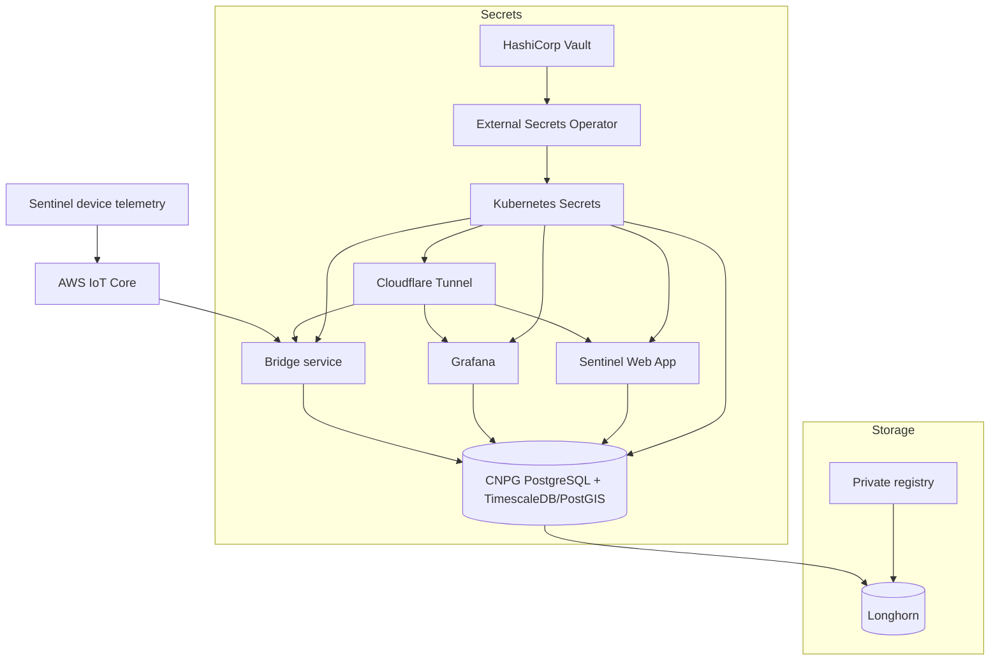

# Sentinel Infrastructure Stack

[](https://kubernetes.io)
[](https://www.postgresql.org)
[](https://www.timescale.com)
[](https://www.vaultproject.io)

Declarative Kubernetes manifests and bootstrap notes for the Sentinel infrastructure stack. The repository provisions Longhorn storage, MetalLB networking, Vault-backed secrets, a CNPG PostgreSQL cluster with TimescaleDB/PostGIS, a private registry, Grafana, an AWS IoT bridge service, and Cloudflare Tunnel ingress.

Use this README as the ordered deployment guide. The raw command reference is kept in [etc/deployment-reference.sh](etc/deployment-reference.sh).

## Architecture



## Repository Layout

```text
.
|-- bridge-service/                  # Node.js MQTT-to-Postgres bridge
|   |-- Dockerfile
|   |-- package.json
|   `-- server.js
|-- sentinel-app/                    # Nuxt 3 water telemetry dashboard
|   |-- Dockerfile
|   |-- package.json
|   `-- app/
|-- spark-etl/                       # PySpark batch telemetry exporter
|   |-- Dockerfile
|   `-- etl.py
|-- etc/
|   |-- deployment-reference.sh       # Raw bare-metal bootstrap reference
|   |-- vault-certmanager-403-troubleshooting.md
|   `-- grafana-dashboards/           # Exported Grafana dashboards
`-- k8s/
    |-- 00-namespace.yaml
    |-- 01-longhorn/                  # StorageClass and Longhorn service
    |-- 02-metal-lb/                  # Optional local LoadBalancer pool
    |-- 03-vault/                     # Vault, cert issuer, watcher, SecretStores
    |-- 04-postgres/                  # ExternalSecret and CNPG cluster
    |-- 05-registry/                  # In-cluster registry on NodePort 30500
    |-- 06-grafana/                   # Grafana service and deployment
    |-- 07-bridge-service/            # Bridge service secrets, service, deployment
    |-- 08-cloudflared/               # Cloudflare Tunnel token and deployment
    |-- 09-hadoop/                    # Simple Hadoop HDFS storage
    |-- 10-sentinel-app/              # Sentinel Web App service and deployment
    |-- 11-uptime-kuma/               # Uptime Kuma monitoring service and deployment
    `-- 12-kubernetes-dashboard/      # Scalable Kubernetes Dashboard in kube-system
```

The numbered `k8s/` directories are ordered by dependency: namespaces, storage and networking, secrets, database, then applications.

## Deployment Prerequisites

The bootstrap commands assume Ubuntu or Debian hosts using `kubeadm`.

Required tools and operators:

- Kubernetes v1.33 or newer.
- containerd.
- Helm.
- Flannel CNI, or another working CNI with the same pod CIDR assumptions adjusted.
- Longhorn.
- MetalLB, if local `LoadBalancer` services are needed.
- External Secrets Operator.
- cert-manager.
- CloudNativePG.
- Metrics Server.
- Docker or another image builder for `bridge-service`.

## Bare-Metal Bootstrap

Run host-level commands on every Kubernetes node unless a step says control plane only.

### 1. Prepare the Host

Disable swap, load Kubernetes networking modules, and enable bridge forwarding:

```bash
sudo apt update && sudo apt upgrade -y
sudo swapoff -a
sudo sed -i '/ swap / s/^/#/' /etc/fstab
sudo systemctl mask swap.target

sudo modprobe overlay
sudo modprobe br_netfilter

sudo tee /etc/sysctl.d/kubernetes.conf <<EOF
net.bridge.bridge-nf-call-ip6tables = 1
net.bridge.bridge-nf-call-iptables = 1
net.ipv4.ip_forward = 1
EOF

sudo sysctl --system
```

### 2. Install and Configure containerd

```bash
sudo apt install -y containerd
sudo mkdir -p /etc/containerd
containerd config default | sudo tee /etc/containerd/config.toml
sudo sed -i 's/SystemdCgroup = false/SystemdCgroup = true/' /etc/containerd/config.toml
sudo systemctl restart containerd
sudo systemctl enable containerd
sudo ctr plugins ls | grep cri
```

If the local registry on NodePort `30500` will be used, configure containerd to allow it:

```bash
sudo mkdir -p /etc/containerd/certs.d/localhost:30500

sudo tee /etc/containerd/certs.d/localhost:30500/hosts.toml <<EOF
server = "http://localhost:30500"

[host."http://localhost:30500"]
  capabilities = ["pull", "resolve", "push"]
  skip_verify = true
EOF

sudo systemctl restart containerd
```

### 3. Install Kubernetes, Helm, and Initialize the Control Plane

Run this section on the control plane node:

```bash
sudo apt install -y apt-transport-https ca-certificates curl gpg
sudo mkdir -p /etc/apt/keyrings

curl -fsSL https://pkgs.k8s.io/core:/stable:/v1.33/deb/Release.key \
  | sudo gpg --dearmor -o /etc/apt/keyrings/kubernetes-apt-keyring.gpg

echo "deb [signed-by=/etc/apt/keyrings/kubernetes-apt-keyring.gpg] https://pkgs.k8s.io/core:/stable:/v1.33/deb/ /" \
  | sudo tee /etc/apt/sources.list.d/kubernetes.list

sudo apt update
sudo apt install -y kubelet kubeadm kubectl
sudo apt-mark hold kubelet kubeadm kubectl

curl https://raw.githubusercontent.com/helm/helm/main/scripts/get-helm-3 | bash

sudo kubeadm config images pull
sudo kubeadm init --pod-network-cidr=10.244.0.0/16

mkdir -p $HOME/.kube
sudo cp -i /etc/kubernetes/admin.conf $HOME/.kube/config
sudo chown $(id -u):$(id -g) $HOME/.kube/config

kubectl get nodes
```

For worker nodes, use the join command generated by kubeadm. You can recreate it from the control plane:

```bash
kubeadm token create --print-join-command
```

For a single-node cluster, allow workloads on the control plane:

```bash
kubectl taint nodes --all node-role.kubernetes.io/control-plane-
```

### 4. Install the CNI

The reference script uses Flannel with pod CIDR `10.244.0.0/16`:

```bash
kubectl apply -f https://github.com/flannel-io/flannel/releases/latest/download/kube-flannel.yml
```

### 5. Install Longhorn

Install host dependencies on every Longhorn node:

```bash
sudo apt install -y open-iscsi nfs-common
sudo systemctl enable iscsid --now
```

Install Longhorn from the control plane:

```bash
kubectl apply -f https://raw.githubusercontent.com/longhorn/longhorn/v1.11.2/deploy/longhorn.yaml
```

If another storage class was previously default, unset it before applying this stack:

```bash
kubectl patch storageclass local-path -p \
  '{"metadata":{"annotations":{"storageclass.kubernetes.io/is-default-class":"false"}}}'
```

Prevent Longhorn volume mount conflicts from `multipathd` on every storage node:

```bash
sudo tee /etc/multipath.conf <<'EOF'
defaults {
    user_friendly_names yes
}

blacklist {
    devnode "^sd[a-z]"
}
EOF

sudo systemctl restart multipathd
sudo multipath -F
```

### 6. Install MetalLB

Enable strict ARP for kube-proxy:

```bash
kubectl get configmap kube-proxy -n kube-system -o yaml \
  | sed -e "s/strictARP: false/strictARP: true/" \
  | kubectl apply -f - -n kube-system
```

Install MetalLB:

```bash
kubectl apply -f https://raw.githubusercontent.com/metallb/metallb/v0.15.3/config/manifests/metallb-native.yaml
kubectl wait --namespace metallb-system --for=condition=ready pod --selector=component=controller --timeout=120s
```

The repository contains an IP pool template in `k8s/02-metal-lb/01-metallb-ippool.yaml`. Update the addresses for your network and uncomment the manifest before applying it.

### 7. Install External Secrets Operator

```bash
helm repo add external-secrets https://charts.external-secrets.io
helm install external-secrets external-secrets/external-secrets \
  -n external-secrets \
  --create-namespace
```

### 8. Install cert-manager

```bash
kubectl apply -f https://github.com/cert-manager/cert-manager/releases/download/v1.20.2/cert-manager.yaml
```

### 9. Install CloudNativePG

```bash
kubectl apply --server-side -f https://raw.githubusercontent.com/cloudnative-pg/cloudnative-pg/release-1.29/releases/cnpg-1.29.1.yaml
curl -sSfL https://github.com/cloudnative-pg/cloudnative-pg/raw/main/hack/install-cnpg-plugin.sh \
  | sudo sh -s -- -b /usr/local/bin
```

### 10. Install Metrics Server

```bash
kubectl apply -f https://github.com/kubernetes-sigs/metrics-server/releases/latest/download/components.yaml
```

For self-hosted clusters where kubelet TLS validation fails, add `--kubelet-insecure-tls`:

```bash
kubectl patch deployment metrics-server -n kube-system --type='json' -p='[
  {
    "op": "add",
    "path": "/spec/template/spec/containers/0/args/-",
    "value": "--kubelet-insecure-tls"
  }
]'
```

## Vault Secrets

The stack uses External Secrets Operator with Vault KV v2 mounted at `sentinel-kv`. The `SecretStore` resources are defined in `k8s/03-vault/07-vault-kvstore.yaml`.

Before deploying workloads that consume secrets, make sure these Vault paths exist:

| Vault path | Required properties |
| --- | --- |
| `prod/postgres` | `user`, `password`, `grafana_rw_user`, `grafana_rw_password`, `grafana_ro_user`, `grafana_ro_password`, `bridge_rw_user`, `bridge_rw_password` |
| `prod/grafana` | `smtp_user`, `smtp_password` |
| `prod/bridge` | `api_key`, `cert`, `key`, `ca` |
| `prod/cloudflared` | `token` |
| `prod/s3backup` | `AWS_ACCESS_KEY_ID`, `AWS_SECRET_ACCESS_KEY`, `AWS_DEFAULT_REGION`, `S3_BUCKET` |

The bridge certificate values should be stored in a format that can be loaded through environment variables. The service converts escaped newlines (`\n`) back into PEM newlines at startup.

## Deploy the Sentinel Stack

### 1. Apply Namespaces

```bash
kubectl apply -f k8s/00-namespace.yaml
```

### 2. Apply Infrastructure Manifests

Apply storage, networking, Vault, Postgres, registry, Grafana, bridge, and Cloudflared manifests in order:

```bash
kubectl apply -f k8s/ -R
```

If applying step-by-step during debugging, use this order:

```bash
kubectl apply -f k8s/01-longhorn/
kubectl apply -f k8s/02-metal-lb/
kubectl apply -f k8s/03-vault/
kubectl apply -f k8s/04-postgres/
kubectl apply -f k8s/05-registry/
kubectl apply -f k8s/06-grafana/
kubectl apply -f k8s/07-bridge-service/
kubectl apply -f k8s/08-cloudflared/
kubectl apply -f k8s/09-hadoop/
kubectl apply -f k8s/10-sentinel-app/
kubectl apply -f k8s/11-uptime-kuma/
kubectl apply -f k8s/12-kubernetes-dashboard/
```

### 3. Build and Push the Bridge Image

The bridge deployment pulls `localhost:30500/bridge-service:1.0.0`.

```bash
sudo apt install -y docker.io

sudo docker build -t bridge-service:1.0.0 bridge-service/
sudo docker tag bridge-service:1.0.0 localhost:30500/bridge-service:1.0.0
sudo docker push localhost:30500/bridge-service:1.0.0
```

### 4. Build and Push the Spark ETL Image

The Spark ETL CronJob pulls `localhost:30500/spark-telemetry-etl:1.0.0`.

```bash
sudo docker build -t spark-telemetry-etl:1.0.0 spark-etl/
sudo docker tag spark-telemetry-etl:1.0.0 localhost:30500/spark-telemetry-etl:1.0.0
sudo docker push localhost:30500/spark-telemetry-etl:1.0.0
```

### 5. Build and Push the Sentinel App Image

The Sentinel App deployment pulls `localhost:30500/sentinel-app:1.0.0`.

```bash
sudo docker build -t sentinel-app:1.0.0 sentinel-app/
sudo docker tag sentinel-app:1.0.0 localhost:30500/sentinel-app:1.0.0
sudo docker push localhost:30500/sentinel-app:1.0.0
```

If Docker tries HTTPS against the local HTTP registry, create Docker auth config for `localhost:30500`:

```bash
mkdir -p ~/.docker
echo -n 'sentinel:<password>' | base64
```

Use the generated base64 value in `~/.docker/config.json`:

```json
{
  "auths": {
    "localhost:30500": {
      "auth": "<base64-value>"
    }
  }
}
```

Copy it for commands run with `sudo`:

```bash
sudo mkdir -p /root/.docker
sudo cp ~/.docker/config.json /root/.docker/config.json
```

Restart the bridge after pushing a new image:

```bash
kubectl rollout restart deployment/bridge -n sentinel-infra
```

### 6. Accessing the Kubernetes Dashboard

The Kubernetes Dashboard is deployed in the `kube-system` namespace.

1. **Accessing via Port Forwarding**:
   ```bash
   kubectl port-forward -n kube-system service/kubernetes-dashboard 8443:443
   ```
   Now access the dashboard at `https://localhost:8443`.

2. **Retrieve the Admin Login Token**:
   Generate an admin token using the helper `admin-user` ServiceAccount:
   ```bash
   kubectl create token admin-user -n kube-system
   ```
   Copy and paste this token into the dashboard login screen.

## Postgres Schema

The CNPG cluster uses `ghcr.io/imusmanmalik/timescaledb-postgis:17-3.5` and initializes:

- `sentinel` database owned by `sentinel`.
- `grafana` database for Grafana application state.
- `devices` table with a generated ULID primary key.
- `device_telemetry` TimescaleDB hypertable for telemetry JSON payloads.
- Application roles for Grafana read/write, Grafana read-only, and bridge read/write access.

## Backup & Recovery

The stack secures S3 backup credentials in Vault under the path `sentinel-kv/<env>/s3backup`. External Secrets Operator (ESO) syncs these credentials to Kubernetes secrets in both the `vault` and `sentinel-infra` namespaces. During an outage, the backup/recovery jobs use cached Kubernetes secrets to execute successfully.

### 1. S3 Backup Credentials Setup

Before running backups, configure S3 credentials in Vault:

| Vault Path | Property | Value |
| --- | --- | --- |
| `sentinel-kv/prod/s3backup` | `AWS_ACCESS_KEY_ID` | `<your-aws-access-key-id>` |
| `sentinel-kv/prod/s3backup` | `AWS_SECRET_ACCESS_KEY` | `<your-aws-secret-access-key>` |
| `sentinel-kv/prod/s3backup` | `AWS_DEFAULT_REGION` | `ap-southeast-1` |
| `sentinel-kv/prod/s3backup` | `S3_BUCKET` | `sentinel-backup-905418361269-us-west-2-an` |

### 2. Vault Backups (Raft Snapshot)

Vault backups run daily via a CronJob that takes a Raft snapshot and uploads it alongside the decrypted unseal keys and root token to S3.

- **Schedule**: Daily at 02:00 AM (`0 2 * * *`).
- **Target Folder**: `s3://sentinel-backup-905418361269-us-west-2-an/vault-backup/<timestamp>/`
- **Trigger Manual Backup Test**:
  ```bash
  kubectl create job vault-backup-test --from=cronjob/vault-backup -n vault
  kubectl logs -n vault -l job-name=vault-backup-test --follow
  ```

### 3. PostgreSQL Backups (CNPG/Barman)

PostgreSQL backups are managed natively by CloudNativePG (CNPG) utilizing Barman.

- **Schedule**: Daily at 02:00 AM (`0 0 2 * * *`).
- **Target Folder**: `s3://sentinel-backup-905418361269-us-west-2-an/postgres-backup/`
- **Verify Archiving Status**:
  ```bash
  kubectl get cluster postgres -n sentinel-infra -o jsonpath='{.status.conditions}'
  ```
- **Trigger Manual Backup**:
  ```bash
  kubectl cnpg backup postgres -n sentinel-infra
  ```

### 4. Recovery Flow

#### Restore PostgreSQL
Apply a restoration cluster configuration pointing to the S3 bucket path (e.g., `cluster-restore.yaml` referencing the backup bucket).

#### Restore Vault
1. Retrieve `vault-keys-<timestamp>.txt` and the latest snapshot `.snap` from S3.
2. Spin up/restart the Vault cluster.
3. Perform a Raft restore:
   ```bash
   vault operator raft snapshot restore /path/to/vault-snapshot-<timestamp>.snap
   ```
4. Manually unseal the nodes with 3 of the 5 keys retrieved from the file:
   ```bash
   vault operator unseal <key1>
   vault operator unseal <key2>
   vault operator unseal <key3>
   ```
5. Authenticate using the root token:
   ```bash
   vault login <root-token>
   ```

## Operations

Check rollout status:

```bash
kubectl get pods -n sentinel-infra
kubectl get externalsecrets -n sentinel-infra
kubectl get cluster -n sentinel-infra
kubectl get pods -n kube-system -l app=registry
```

Restart applications after secret or image changes:

```bash
kubectl rollout restart deployment/grafana -n sentinel-infra
kubectl rollout restart deployment/bridge -n sentinel-infra
kubectl rollout restart deployment/cloudflared -n sentinel-infra
kubectl rollout restart deployment/sentinel-app -n sentinel-infra
```

Troubleshoot Longhorn mount issues:

```bash
sudo fuser -v /dev/sdc
sudo multipath -ll
sudo multipath -F
kubectl delete pod -n sentinel-infra -l app=<app-name>
```

## Security

Do not commit plaintext credentials, private keys, Cloudflare tunnel tokens, or AWS IoT certificates. Kubernetes secrets in this repository are declared as `ExternalSecret` resources and are populated from Vault at runtime.
