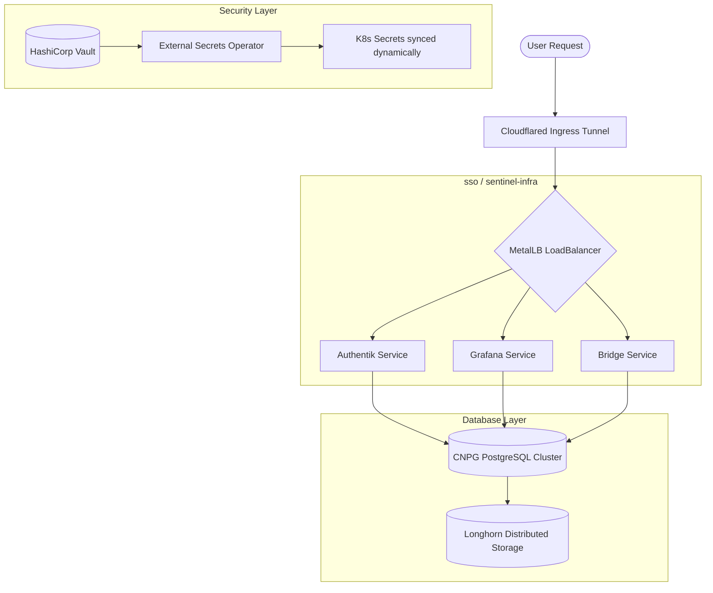

# Sentinel Infrastructure Stack

[](https://kubernetes.io)
[](https://www.postgresql.org)
[](https://www.timescale.com)
[](https://www.vaultproject.io)
[]()

This repository contains GitOps-aligned, declarative Kubernetes manifests and bootstrapping resources for provisioning the **Sentinel Infrastructure Stack**. The architecture provides distributed block storage, dynamic secrets management, automated database clustering, user SSO identity verification, telemetry dashboards, and API gateway routing.

---

## 🏗️ Architecture & Component Flow

The flow below details how external traffic enters the cluster, how databases write to distributed storage, and how credentials sync from HashiCorp Vault into Kubernetes namespace secrets.



---

## 📂 Repository Structure

The `k8s/` directory is organized sequentially to resolve resource dependencies cleanly during a recursive deployment.

```
.
├── LICENSE
├── README.md
├── k8s/
│   ├── 00-namespace.yaml                 # Namespaces: sentinel-infra, vault, sso
│   ├── 01-longhorn/                      # Longhorn distributed block storage
│   │   ├── 01-longhorn-storageclass.yaml
│   │   └── 02-longhorn-service.yaml
│   ├── 02-metal-lb/                      # MetalLB LoadBalancer pool setup
│   │   ├── 01-metallb-ippool.yaml
│   │   └── 02-metallb-l2advertisement.yaml
│   ├── 03-vault/                         # Vault StatefulSets & secret syncing
│   │   ├── 01-vault-rbac.yaml
│   │   ├── 02-vault-issuer.yaml
│   │   ├── 03-vault-configmap.yaml
│   │   ├── 04-vault-service.yaml
│   │   ├── 05-vault-statefulset.yaml
│   │   ├── 06-vault-watcher-job.yaml
│   │   └── 07-vault-kvstore.yaml
│   ├── 04-postgres/                      # CNPG PostgreSQL cluster setup
│   │   ├── 01-postgres-secret.yaml
│   │   └── 02-postgres-cluster.yaml
│   ├── 05-registry/                      # Local private container registry
│   │   ├── 01-registry-secret.yaml
│   │   ├── 02-registry-service.yaml
│   │   ├── 03-registry-pvc.yaml
│   │   └── 04-registry-deployment.yaml
│   ├── 06-authentik/                     # Authentik SSO & Worker nodes
│   │   ├── 01-authentik-sa.yaml
│   │   ├── 02-authentik-configmap.yaml
│   │   ├── 03-authentik-secret.yaml
│   │   ├── 04-authentik-pvc.yaml
│   │   ├── 05-authentik-server-deployment.yaml
│   │   ├── 06-authentik-service.yaml
│   │   └── 07-authentik-worker-deployment.yaml
│   ├── 07-grafana/                       # Grafana config maps and dashboards
│   │   ├── 01-grafana-configmap.yaml
│   │   ├── 02-grafana-service.yaml
│   │   └── 03-grafana-deployment.yaml
│   ├── 08-bridge-service/                # Sentinel Bridge app service
│   │   ├── 01-bridge-secret.yaml
│   │   ├── 02-bridge-service.yaml
│   │   └── 03-bridge-deployment.yaml
│   └── 09-cloudflared/                   # Cloudflare Tunnel ingress configurations
│       ├── 01-cloudflared-secret.yaml
│       └── 02-cloudflared-deployment.yaml
├── bridge-service/                       # Local bridge service source
│   ├── Dockerfile
│   ├── package.json
│   └── server.js
└── developer-notes/
    └── deployment-reference.sh           # Bare-Metal cluster bootstrap script
```

---

## 🚀 Systematic Cluster Deployment Guide

This guide details the complete, raw commands required to prepare nodes, bootstrap the Kubernetes control plane, and deploy the application stack.

### Phase 1: Host Preparation & Network Tuning

Perform these steps on all bare-metal nodes (Ubuntu/Debian) to ensure kernel limits and networking requirements are met.

```bash
# Update and upgrade core packages
sudo apt update && sudo apt upgrade -y

# Disable Swap (Kubernetes requirement)
sudo swapoff -a
sudo sed -i '/ swap / s/^/#/' /etc/fstab
sudo systemctl mask swap.target

# Load required kernel modules
sudo modprobe overlay
sudo modprobe br_netfilter

# Configure sysctl network parameters for bridges
sudo tee /etc/sysctl.d/kubernetes.conf <<EOF
net.bridge.bridge-nf-call-ip6tables = 1
net.bridge.bridge-nf-call-iptables = 1
net.ipv4.ip_forward = 1
EOF

# Apply sysctl settings
sudo sysctl --system
```

---

### Phase 2: Container Runtime (Containerd) Setup

Install and configure `containerd` to act as the Container Runtime Interface (CRI).

```bash
# Install containerd package
sudo apt install -y containerd

# Generate default configuration
sudo mkdir -p /etc/containerd
containerd config default | sudo tee /etc/containerd/config.toml

# Configure containerd to use SystemdCgroup
sudo sed -i 's/SystemdCgroup = false/SystemdCgroup = true/' /etc/containerd/config.toml

# Restart runtime and verify
sudo systemctl restart containerd
sudo systemctl enable containerd
sudo ctr plugins ls | grep cri
```

#### Configure Insecure Private Registry Path
To pull images from the registry running within the cluster on port `30500` without SSL verification:

```bash
sudo mkdir -p "/etc/containerd/certs.d/localhost:30500"
sudo tee "/etc/containerd/certs.d/localhost:30500/hosts.toml" <<EOF
server = "http://localhost:30500"

[host."http://localhost:30500"]
  capabilities = ["pull", "resolve", "push"]
  skip_verify = true
EOF

sudo sysctl --system
sudo ctr plugins ls | grep cri
```

---

### Phase 3: Docker & Local Container Build Pipeline

Set up Docker to build and push the local bridge service image.

```bash
# Install Docker Engine
sudo apt install docker.io -y

# Build the bridge-service image
sudo docker build -t bridge-service:1.0.0 bridge-service/

# Tag the image for the local registry
sudo docker tag bridge-service:1.0.0 localhost:30500/bridge-service:1.0.0

# Push the image to the local registry
sudo docker push localhost:30500/bridge-service:1.0.0
```

> [!TIP]
> If you encounter HTTPS handshake or validation errors from the Docker client when targeting the local registry, configure credential mapping:
> ```bash
> mkdir -p ~/.docker
> # Create base64 credential payload
> echo -n 'sentinel:<password>' | base64
>
> # Write ~/.docker/config.json with auth token
> cat > ~/.docker/config.json << 'EOF'
> {
>   "auths": {
>     "localhost:30500": {
>       "auth": "<base64-encoded-auth-token>"
>     }
>   }
> }
> EOF
>
> # Apply credentials to the root user config
> sudo mkdir -p /root/.docker
> sudo cp ~/.docker/config.json /root/.docker/config.json
> ```

---

### Phase 4: Kubernetes Control Plane Bootstrap

Initialize the Kubernetes control plane using `kubeadm`.

```bash
# Install prerequisite packages for APT transport
sudo apt install -y apt-transport-https ca-certificates curl gpg
sudo mkdir -p /etc/apt/keyrings

# Add Kubernetes APT repository for v1.33 stable release
curl -fsSL https://pkgs.k8s.io/core:/stable:/v1.33/deb/Release.key | sudo gpg --dearmor -o /etc/apt/keyrings/kubernetes-apt-keyring.gpg
echo "deb [signed-by=/etc/apt/keyrings/kubernetes-apt-keyring.gpg] https://pkgs.k8s.io/core:/stable:/v1.33/deb/ /" | sudo tee /etc/apt/sources.list.d/kubernetes.list

# Install packages and pin versions
sudo apt update
sudo apt install -y kubelet kubeadm kubectl
sudo apt-mark hold kubelet kubeadm kubectl

# Install Helm 3 CLI
curl https://raw.githubusercontent.com/helm/helm/main/scripts/get-helm-3 | bash

# Bootstrap control plane with Flannel CIDR
kubeadm config images pull
sudo kubeadm init --pod-network-cidr=10.244.0.0/16

# Configure kubectl for administrative user
mkdir -p $HOME/.kube
sudo cp -i /etc/kubernetes/admin.conf $HOME/.kube/config
sudo chown $(id -u):$(id -g) $HOME/.kube/config

# Install Flannel CNI
kubectl apply -f https://github.com/flannel-io/flannel/releases/latest/download/kube-flannel.yml
```

---

### Phase 5: Cluster Infrastructure Operators & Setup

Install operators and cluster dependencies sequentially.

#### 1. Longhorn Distributed Block Storage
Deploy Longhorn storage drivers and blacklist local SCSI controllers to avoid multipath configuration clashes.

```bash
# Install kernel prerequisites
sudo apt install open-iscsi nfs-common -y
sudo systemctl enable iscsid --now

# Deploy Longhorn manifest
kubectl apply -f https://raw.githubusercontent.com/longhorn/longhorn/v1.11.2/deploy/longhorn.yaml

# Disable default storage class annotation from local-path if it exists
kubectl patch storageclass local-path -p \
  '{"metadata":{"annotations":{"storageclass.kubernetes.io/is-default-class":"false"}}}'
```

> [!WARNING]
> Blacklist `sd` devices on all host nodes to prevent the OS `multipathd` service from seizing block devices designated for Longhorn:
> ```bash
> sudo tee /etc/multipath.conf << 'EOF'
> defaults {
>     user_friendly_names yes
> }
> blacklist {
>     devnode "^sd[a-z]"
> }
> EOF
> sudo systemctl restart multipathd
> sudo multipath -F
> ```

#### 2. MetalLB LoadBalancer CNI
Enable strict ARP mode in `kube-proxy` config and install MetalLB:

```bash
# Update kube-proxy for strict ARP compliance
kubectl get configmap kube-proxy -n kube-system -o yaml | sed -e "s/strictARP: false/strictARP: true/" | kubectl apply -f - -n kube-system

# Install MetalLB manifests
kubectl apply -f https://raw.githubusercontent.com/metallb/metallb/v0.15.3/config/manifests/metallb-native.yaml

# Wait for controller deployment readiness
kubectl wait --namespace metallb-system --for=condition=ready pod --selector=component=controller --timeout=120s
```

#### 3. External Secrets Operator (ESO)
Install ESO to facilitate dynamic sync from HashiCorp Vault:

```bash
helm repo add external-secrets https://charts.external-secrets.io
helm install external-secrets external-secrets/external-secrets -n external-secrets --create-namespace
```

#### 4. Cert-Manager
Install cluster certificate controller manifests:

```bash
kubectl apply -f https://github.com/cert-manager/cert-manager/releases/download/v1.20.2/cert-manager.yaml
```

#### 5. CloudNative PG (CNPG)
Install the PostgreSQL database controller and its CLI plugins:

```bash
# Deploy PostgreSQL operator
kubectl apply --server-side -f https://raw.githubusercontent.com/cloudnative-pg/cloudnative-pg/release-1.29/releases/cnpg-1.29.1.yaml

# Install CNPG kubectl plugin
curl -sSfL https://github.com/cloudnative-pg/cloudnative-pg/raw/main/hack/install-cnpg-plugin.sh | sudo sh -s -- -b /usr/local/bin
```

#### 6. Metrics Server
Install resource monitoring server and patch TLS flags for self-signed certificates:

```bash
kubectl apply -f https://github.com/kubernetes-sigs/metrics-server/releases/latest/download/components.yaml

# Patch server deployment to skip kubelet TLS validation
kubectl patch deployment metrics-server -n kube-system --type='json' -p='[
  {
    "op": "add",
    "path": "/spec/template/spec/containers/0/args/-",
    "value": "--kubelet-insecure-tls"
  }
]'
```

---

### Phase 6: Application Stack Deployment

Deploy the declarative configurations under `k8s/` recursively.

```bash
# Create namespaces
kubectl apply -f k8s/00-namespace.yaml

# Deploy all stack components in dependency order
kubectl apply -f k8s/ -R
```

#### Sequence Flow:
1. **[00-namespace.yaml](file:///d:/WebstormProjects/sentinel-infra/k8s/00-namespace.yaml)**: Configures core namespaces (`sentinel-infra`, `vault`, `sso`).
2. **[01-longhorn/](file:///d:/WebstormProjects/sentinel-infra/k8s/01-longhorn)**: Configures the persistent volume claim storage rules.
3. **[02-metal-lb/](file:///d:/WebstormProjects/sentinel-infra/k8s/02-metal-lb)**: Provisions pool ranges for localized load balancers.
4. **[03-vault/](file:///d:/WebstormProjects/sentinel-infra/k8s/03-vault)**: Boots up HashiCorp Vault.
5. **[04-postgres/](file:///d:/WebstormProjects/sentinel-infra/k8s/04-postgres)**: Initializes the HA Postgres database cluster.
6. **[05-registry/](file:///d:/WebstormProjects/sentinel-infra/k8s/05-registry)**: Launches local container hosting service.
7. **[06-authentik/](file:///d:/WebstormProjects/sentinel-infra/k8s/06-authentik)**: Deploys SSO gateway and background execution workers.
8. **[07-grafana/](file:///d:/WebstormProjects/sentinel-infra/k8s/07-grafana)**: Sets up monitoring interface.
9. **[08-bridge-service/](file:///d:/WebstormProjects/sentinel-infra/k8s/08-bridge-service)**: Provisions API connector logic.
10. **[09-cloudflared/](file:///d:/WebstormProjects/sentinel-infra/k8s/09-cloudflared)**: Maps ingress endpoint tunnels for public ingress.

---

## 🛠️ Operations & Troubleshooting Playbook

### Single-Node Scaling
By default, the Kubernetes control plane node refuses user workloads. If deploying to a single-node bare-metal cluster, untaint the node to allow Pod scheduling:
```bash
kubectl taint nodes --all node-role.kubernetes.io/control-plane-
```

### Adding Cluster Worker Nodes
To generate the registration payload required to bind new worker nodes to the control plane:
```bash
kubeadm token create --print-join-command
```

### Unlocking Longhorn Block Storage mounts
If a pod is stuck in `ContainerCreating` with volume mount attachment errors, verify if `multipathd` is locking the SCSI device:

```bash
# Locate active device processes (replace sdc with relevant device)
sudo fuser -v /dev/sdc

# Show active multi-path maps
sudo multipath -ll

# Flush unused device mapper mappings
sudo multipath -F

# Force restart target pod
kubectl delete pod -n sentinel-infra -l app=<nama-app>
```

---

## 🔒 Security & Secrets Policy

Credential security is maintained using GitOps best practices. All secrets and certs are decoupled from raw YAML manifests.

* **Vault Integration**: HashiCorp Vault acts as the source-of-truth.
* **ESO sync**: The `ExternalSecrets` CRD retrieves secrets and maps them dynamically to local namespace Secret contexts.
* **Hardening**: Plaintext secrets must not be committed to this repository. Use `ExternalSecrets` parameters to references keys dynamically.
