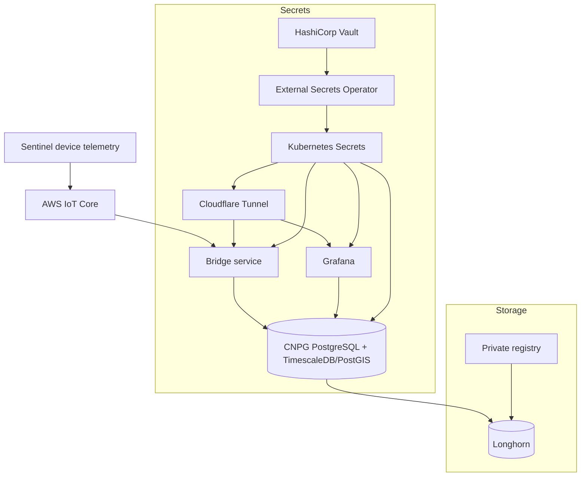

# Sentinel Infrastructure Stack

[](https://kubernetes.io)
[](https://www.postgresql.org)
[](https://www.timescale.com)
[](https://www.vaultproject.io)

Declarative Kubernetes manifests and bootstrap notes for the Sentinel infrastructure stack. The repository provisions storage, networking, Vault-backed secrets, a TimescaleDB/PostGIS database, a private registry, Grafana, an AWS IoT bridge service, and Cloudflare Tunnel ingress.

## Architecture



## Repository Layout

```text
.
|-- bridge-service/                  # Node.js MQTT-to-Postgres bridge
|   |-- Dockerfile
|   |-- package.json
|   `-- server.js
|-- etc/
|   |-- deployment-reference.sh       # Bare-metal bootstrap reference
|   |-- vault-certmanager-403-troubleshooting.md
|   `-- grafana-dashboards/           # Exported Grafana dashboards
`-- k8s/
    |-- 00-namespace.yaml
    |-- 01-longhorn/                  # StorageClass and Longhorn service
    |-- 02-metal-lb/                  # Optional local LoadBalancer pool
    |-- 03-vault/                     # Vault, cert issuer, watcher, SecretStores
    |-- 04-postgres/                  # ExternalSecret and CNPG cluster
    |-- 05-registry/                  # In-cluster registry on NodePort 30500
    |-- 06-grafana/                   # Grafana service and deployment
    |-- 07-bridge-service/            # Bridge service secrets, service, deployment
    `-- 08-cloudflared/               # Cloudflare Tunnel token and deployment
```

The numbered `k8s/` directories are ordered by dependency: namespaces, storage and networking, secrets, database, then applications.

## Prerequisites

Use `etc/deployment-reference.sh` as the full bare-metal reference. At minimum, the cluster needs:

- Kubernetes v1.33 or newer with a working CNI.
- Longhorn installed, with `open-iscsi` and `nfs-common` on storage nodes.
- MetalLB installed if you want local `LoadBalancer` services.
- External Secrets Operator.
- cert-manager.
- CloudNativePG.
- Metrics Server if you want cluster metrics in dashboards.
- A reachable HashiCorp Vault instance from inside the cluster.
- Docker or another image builder for `bridge-service`.

For single-node clusters, allow pods on the control plane:

```bash
kubectl taint nodes --all node-role.kubernetes.io/control-plane-
```

## Required Vault Secrets

ExternalSecret resources expect these Vault KV v2 paths under `sentinel-kv`:

| Vault path | Required properties |
| --- | --- |
| `prod/postgres` | `user`, `password`, `grafana_rw_user`, `grafana_rw_password`, `grafana_ro_user`, `grafana_ro_password`, `bridge_rw_user`, `bridge_rw_password` |
| `prod/grafana` | `smtp_user`, `smtp_password` |
| `prod/bridge` | `api_key`, `cert`, `key`, `ca` |
| `prod/cloudflared` | `token` |

The bridge certificate values should be stored in a format that can be loaded through environment variables. The service converts escaped newlines (`\n`) back into PEM newlines at startup.

## Deployment

Install the base namespaces first:

```bash
kubectl apply -f k8s/00-namespace.yaml
```

Install the external operators listed in `etc/deployment-reference.sh`, then apply the stack:

```bash
kubectl apply -f k8s/ -R
```

If you use the local registry, build and push the bridge image before deploying or restarting the bridge pod:

```bash
docker build -t bridge-service:1.0.0 bridge-service/
docker tag bridge-service:1.0.0 localhost:30500/bridge-service:1.0.0
docker push localhost:30500/bridge-service:1.0.0
```

The bridge deployment pulls `localhost:30500/bridge-service:1.0.0`, so every node must be configured to trust or allow the registry endpoint. The containerd example is in `etc/deployment-reference.sh`.

## Postgres Schema

The CNPG cluster uses `ghcr.io/imusmanmalik/timescaledb-postgis:17-3.5` and initializes:

- `sentinel` database owned by `sentinel`.
- `grafana` database for Grafana application state.
- `devices` table with a generated ULID primary key.
- `device_telemetry` TimescaleDB hypertable for telemetry JSON payloads.
- Application roles for Grafana read/write, Grafana read-only, and bridge read/write access.

## Operations

Check rollout status:

```bash
kubectl get pods -n sentinel-infra
kubectl get externalsecrets -n sentinel-infra
kubectl get cluster -n sentinel-infra
```

Restart an app after a secret or image change:

```bash
kubectl rollout restart deployment/grafana -n sentinel-infra
kubectl rollout restart deployment/bridge -n sentinel-infra
kubectl rollout restart deployment/cloudflared -n sentinel-infra
```

Troubleshoot Longhorn mount issues caused by `multipathd`:

```bash
sudo fuser -v /dev/sdc
sudo multipath -ll
sudo multipath -F
```

To prevent the issue permanently on Longhorn nodes, blacklist SCSI devices in `/etc/multipath.conf` as shown in `etc/deployment-reference.sh`.

## Security

Do not commit plaintext credentials, private keys, Cloudflare tunnel tokens, or AWS IoT certificates. Kubernetes secrets in this repository are declared as `ExternalSecret` resources and are populated from Vault at runtime.
